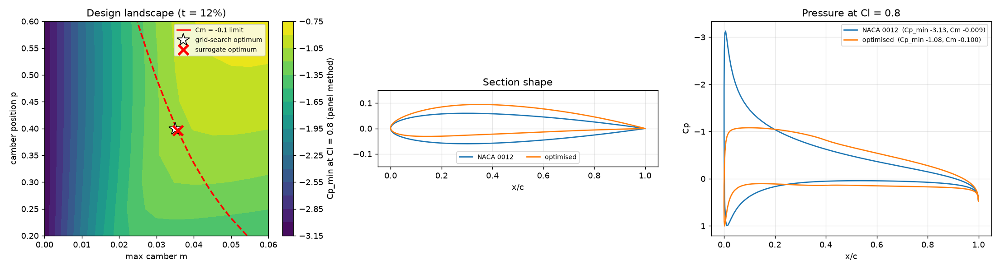
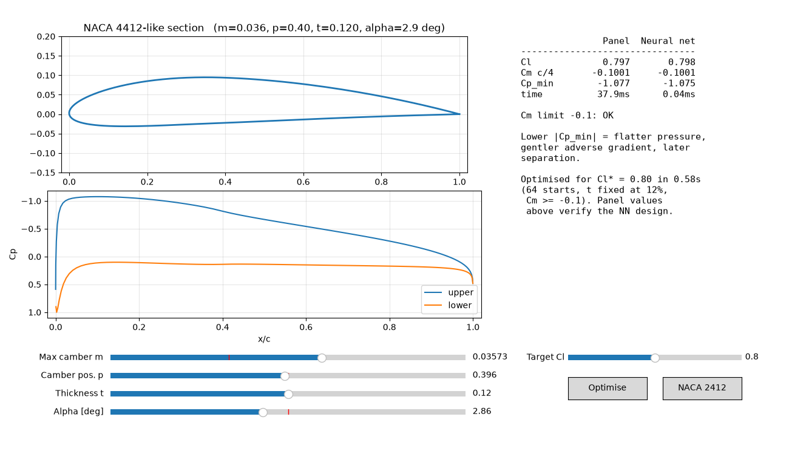

# Physics-generated neural surrogate for airfoil design

A self-contained aerospace machine-learning project. It needs **no external data,
no CFD package and no deep-learning framework**, only `numpy` and `matplotlib`.

1. **Physics solver from scratch:** a Hess–Smith panel method (source panels
   plus vortex, with a Kutta condition) computes inviscid pressure, lift and moment
   for any NACA 4-digit airfoil. It is validated against thin-airfoil theory.
2. **Synthetic dataset:** 4,000 Latin-hypercube designs over camber, camber
   position, thickness and angle of attack, each solved with the panel code.
3. **Neural surrogate from scratch:** a numpy MLP with hand-written backprop, Adam,
   cosine learning-rate decay and early stopping. It predicts Cl, Cm and peak suction
   Cp_min, and is benchmarked against thin-airfoil theory and quadratic regression.
4. **Gradient-based design:** backprop *to the inputs* makes the surrogate
   differentiable. 64 random starts are optimised in parallel, and every result is
   checked against the true solver.



## Results

### 1. Solver validation (`figures/01_solver_validation.png`)
| Check | Panel method | Theory |
|---|---|---|
| Lift slope, NACA 2412 | 6.864 /rad | 2π(1+0.77t) = 6.864 /rad |
| Cm_c/4, NACA 2412 | −0.060 | −0.053 (thin-airfoil, no thickness) |
| Symmetric airfoil at α = 0 | Cl = 0, Cm = 0 | 0, 0 |

Pressure-integrated lift agrees with Kutta–Joukowski lift to within 0.5%, and Cl converges
as panels are added (140 panels are used, within about 0.5% of the converged value).

### 2. Surrogate accuracy on 400 held-out designs (`figures/02_surrogate_parity.png`)
| Output | Thin-airfoil theory | Quadratic regression | Neural surrogate |
|---|---|---|---|
| Cl | RMSE 0.1008, R² 0.9718 | RMSE 0.0036, R² 1.0000 | **RMSE 0.0012** |
| Cm_c/4 | RMSE 0.0107, R² 0.9578 | RMSE 0.0008, R² 0.9998 | **RMSE 0.0001** |
| Cp_min | n/a | RMSE 1.3457, R² 0.8505 | **RMSE 0.0450, R² 0.9998** |

Lift and moment are almost linear in the inputs, so a simple response surface already
does well on them. The **suction peak** is strongly nonlinear: it runs from −0.24 to −25
near the leading edge. There the network is **about 30× more accurate** than quadratic
regression. Training on log(−Cp_min) instead of Cp_min was the key modelling choice.
The data-efficiency curve (`figures/03_data_efficiency.png`) shows the error falling
steadily from 100 to 3,200 training samples.

### 3. Design optimisation (`figures/04_optimisation.png`, `figures/05_design_sweep.png`)
**Problem:** for a 12%-thick section (structural requirement), choose camber m,
camber position p and angle of attack α to reach a target Cl with the **smallest suction
peak**. A flatter pressure distribution means a milder adverse pressure gradient, so later
separation and a gentler stall. The design must also satisfy **Cm_c/4 ≥ −0.10**
(trim/tail-load limit).

| Target Cl | Surrogate design (m, p, α) | Panel-verified Cp_min | Grid-search optimum | NACA 0012 | Peak reduction |
|---|---|---|---|---|---|
| 0.4 | 0.026, 0.60, −0.1° | −0.593 | −0.601 | −1.236 | 52% |
| 0.6 | 0.030, 0.50, 1.4° | −0.808 | −0.816 | −2.035 | 60% |
| 0.8 | 0.036, 0.40, 2.9° | −1.077 | −1.087 | −3.130 | 65% |
| 1.0 | 0.040, 0.32, 4.3° | −1.413 | −1.446 | −4.528 | 69% |
| 1.2 | 0.044, 0.26, 5.8° | −1.827 | −1.854 | −6.187 | 70% |

* The surrogate's predictions at its optimum match the panel solver to within 0.01 in
  Cp_min and 0.002 in Cl. The optimiser does not exploit surrogate error.
* The surrogate optimum matches or slightly beats a brute-force grid search done entirely
  with the panel solver (117 designs × trimming per target). The small gain comes from
  searching continuously instead of on a grid.
* The physics is sensible. The Cm constraint is always active: more camber flattens
  the pressure peak but increases nose-down moment. As the lift target rises, the optimiser
  moves maximum camber **forward**, which loads the leading edge through camber
  instead of angle of attack.
* Each optimisation on the surrogate takes about 0.2 s (64 starts × 1,500 Adam steps).

## Run it
```bash
python -m pip install -r requirements.txt   # numpy + matplotlib only
python run_all.py                           # tests -> validation -> data -> train -> optimise
```
Then open the interactive app:
```bash
python app.py
```
Sliders change camber, camber position, thickness and angle of attack. The panel solver
recomputes the pressure distribution live (about 30 ms), with the neural network's
prediction (about 0.05 ms) next to it. **Optimise** runs the surrogate design search for
the chosen target Cl.



Or run steps individually: `scripts/validate_solver.py`, `generate_data.py` (about 4 min),
`train_surrogate.py` (about 3 min), `optimize_design.py` (about 1 min).
`python tests/test_physics.py` runs the physics checks and a finite-difference check of the
network's input gradients.

## Layout
```
aeroml/geometry.py      NACA 4-digit coordinates, cosine spacing
aeroml/panel.py         Hess–Smith panel method (vectorised numpy)
aeroml/thin_airfoil.py  Glauert thin-airfoil theory baseline
aeroml/mlp.py           MLP, backprop, Adam, input-gradient (VJP)
scripts/                pipeline steps
tests/test_physics.py   physics and gradient-correctness tests
results/                generated metric tables
figures/                generated plots
```

## Limitations and next steps
* **Inviscid model:** no drag, no viscous Cl reduction, no stall prediction. Cp_min is
  a *proxy* for separation tendency. Next step: add a viscous boundary-layer model
  (Thwaites laminar + Head turbulent) to predict drag and optimise L/D.
* **Shape family:** NACA 4-digit has only 3 shape parameters. CST or Bézier
  parameterisations would allow reflexed and supercritical sections.
* **Multi-fidelity:** train on cheap panel data, then fine-tune on a few XFOIL/RANS
  results (transfer learning across fidelities).
* **Physics-informed variants:** learn the residual relative to thin-airfoil theory, or
  predict the full Cp distribution instead of scalars.
